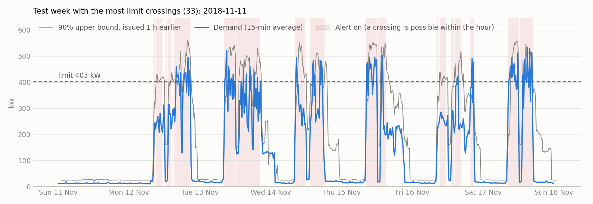

# Steel plant peak demand: one-hour-ahead forecast and alert

[](https://github.com/ankitsingathia/steel-peak-demand/actions/workflows/tests.yml)

An industrial electricity bill has a demand charge set by the highest 15-minute block of the month. One bad quarter-hour sets the charge for the whole month, and crossing the contracted demand adds a penalty on top. A plant usually finds out after the block has ended.

This project forecasts a steel plant's demand for the next four 15-minute blocks and warns when the next hour could cross a limit. That gives the operators time to hold back a deferrable load. I work in energy and utilities at a steel pipe plant. Plant data stays inside the plant, so everything here runs on a public dataset from another steel plant, and every number comes from a script in this repo.

| | Result (Nov–Dec 2018, never seen in training) |
|---|---|
| What most notebooks on this data report | R² 0.998, using columns measured in the same block. That isn't a forecast. |
| Honest forecast, 15 minutes ahead | R² 0.93, MAE 16.0 kW, 22% below repeating the last block |
| Honest forecast, 1 hour ahead | MAE 25.7 kW, 46% below repeating the last block |
| Limit crossings warned about within the hour (403 kW limit) | **77 of 78** with the 90% upper bound, against 52 for an operator watching current demand |
| November's peak, if the warned crossings had been held at the limit | **628.7 → 436.3 kW** (−31%) |
| LSTM and Transformer (3 seeds each) | The LSTM is 2–6% better than gradient boosting on overall error one hour ahead, but **worse on the peak blocks**, so gradient boosting drives the alert |

---

## The data, and what was wrong with it

[UCI dataset 851](https://archive.ics.uci.edu/dataset/851/steel+industry+energy+consumption): one year (2018) of 15-minute readings from a steel plant in South Korea. It has active energy, reactive energy, power factor, CO₂ and a load-type label: 35,040 blocks in all. Demand in kW is the block's kWh × 4. The plant draws 10–20 kW at night and 400–630 kW at its peaks.

**The midnight block is stamped a day early.** Each day's last block (ending at 24:00) carries that day's date at 00:00. Read literally, 365 blocks sit at the start of their day instead of the end, and the file is out of time order. Two checks agree on where they belong:
- **File order:** the row comes right after 23:45.
- **The readings:** each one differs from its file neighbours by 1.3 kWh on average, but by 4.2 kWh from the same date's 00:15.

After a one-day shift, the timeline is a clean 15-minute grid from 00:15 on 1 Jan 2018 to 00:00 on 1 Jan 2019.

**CO₂ is the target in disguise.** It is kWh × 0.00046, rounded to two decimals (correlation 0.988). The lagging power factor is computed exactly from the same block's kWh and kVArh.

**Load_Type is not a leak.** It looks derived from the load, but every day in the file follows exactly one of three fixed patterns:

| Pattern | Days |
|---|---|
| Spring–autumn time-of-use bands | 208 |
| Winter time-of-use bands | 95 |
| "Light" all day (Sundays and public holidays) | 62 |

So it is a time-of-use calendar, known in advance. It also works as a holiday calendar.

Tests pin all three findings (`tests/test_peakcast.py`).

## The leak, measured

| Setup | R² | MAE |
|---|---|---|
| Same-block CO₂, reactive energy and power factor, random 70/30 split | **0.998** | 2.3 kW |
| Honest 15-minute-ahead forecast, chronological split | 0.932 | 16.0 kW |

The first row predicts a block from things measured in that block. Useful for filling a missing reading, but no help in avoiding a peak. Everything below uses only what is known when the forecast is made: demand up to the current block, the same block 1 and 7 days earlier, and the target block's calendar and tariff band. One test changes demand after the forecast time and checks that no feature moves.

The split is chronological: train January–September, calibrate on October, test November–December.

## Forecast accuracy

| 15 min ahead | MAE (kW) | WAPE | R² | Error on blocks above the limit (MAE / mean) |
|---|---|---|---|---|
| Same block last week | 50.9 | 0.512 | 0.387 | 207 / −201 |
| Same block yesterday | 57.5 | 0.577 | 0.267 | 201 / −199 |
| Repeat the last block | 20.6 | 0.207 | 0.856 | 87 / −60 |
| **Gradient boosting** | **16.0** | **0.161** | **0.932** | 70 / −67 |

| 1 hour ahead | MAE (kW) | WAPE | R² | Error on blocks above the limit (MAE / mean) |
|---|---|---|---|---|
| Repeat the last block | 47.6 | 0.478 | 0.389 | 168 / −152 |
| **Gradient boosting** | **25.7** | **0.258** | **0.847** | 99 / −98 |

MAPE isn't used. At 15 kW of night load, a 10 kW miss would count as 67%, so MAPE would rank models by how they do at 3 a.m.

### LSTM and Transformer

Both read the last 8 hours of demand and calendar, plus each target block's demand a day and a week earlier (the same lags gradient boosting gets), and forecast all four blocks of the next hour together. Both have about 24,000 parameters. They were trained on January–September with early stopping on October, 3 seeds each. Gradient boosting is refitted on January–September only for this table, so no model trains on October.

| | 15 min ahead, MAE | 1 h ahead, MAE | 1 h ahead, blocks above the limit (MAE / mean error) |
|---|---|---|---|
| Repeat the last block | 20.6 kW | 47.6 kW | 167 / −151 kW |
| Gradient boosting | **15.8 kW** | 26.0 kW | **101 / −101 kW** |
| LSTM | 17.1–18.2 kW | **24.6–25.5 kW** | 120–130 / −120 to −130 kW |
| Transformer | 17.5–19.3 kW | 25.7–29.0 kW | 118–139 / −118 to −139 kW |

**The LSTM wins on average one hour ahead, and loses where it counts.** Its overall error is 2–6% below gradient boosting's at the one-hour horizon. On the blocks above the limit, the ones a demand charge depends on, its error is 18–29% higher, and it under-predicts peaks by more. Averaged over every 15 minutes of the day, most blocks are flat night or steady day load. A model that tracks those well can win the average while flattening the spikes. The Transformer is no better than the LSTM and varies more between seeds (25.7–29.0 kW).

So gradient boosting stays the model behind the alert. Reporting average error alone would have picked the wrong one.

Reproduce: `python scripts/run_seq.py` (`results/sequence.json`, about 15 minutes on a laptop CPU).

## Why the alert can't use the forecast itself

Every model under-predicts the peaks: by 67 kW on average at 15 minutes, and by 98 kW at one hour. A squared-error model hedges towards the typical value, and a peak is by definition not typical. The peaks are also short. Over the year, 62% of limit crossings last a single block, and the median overshoot is 51 kW. Only 37% start from a demand that was already above 90% of the limit an hour earlier.

So the alert uses a **conformal upper bound**:
1. Fit on January–September.
2. Measure the absolute errors on October, separately for each tariff band (night errors are a few kW; maximum-band errors are tens).
3. Add that band's 80th, 90th or 95th percentile error to each forecast.

In the test the 90% bounds covered 91–92% of blocks at every horizon, as they should. The 80% bounds covered only 70–78%. October uses the spring–autumn tariff pattern and the test uses the winter one. That is reported here rather than tuned away.

## The alert

At the end of every block, the alert warns if the upper bound for any of the next four blocks is above the limit. The plant's contract demand isn't in the data, so the limit is the 95th percentile of January–September demand (403 kW), fixed before any test scoring. The 99th percentile (493 kW) is reported as a second case.

**Limit 403 kW** (78 crossings in the test):

| Rule | Crossings warned about in the hour before | Median warning | False alerts per week | Time in alert |
|---|---|---|---|---|
| Operator: current demand above 90% of the limit | 52 | 52 min | 7.2 | 4.4% |
| Point forecast above the limit | 47 | 60 min | 2.9 | 3.5% |
| 80% upper bound above the limit | 73 | 60 min | 11.6 | 8.3% |
| **90% upper bound above the limit** | **77** | 60 min | 19.5 | 17.1% |

**Limit 493 kW** (34 crossings):

| Rule | Warned about | False alerts per week | Time in alert |
|---|---|---|---|
| Operator rule | 24 | 5.4 | 1.7% |
| Point forecast | **0** | 0 | 0% |
| 80% upper bound | 22 | 3.7 | 1.9% |
| **90% upper bound** | **33** | 6.8 | 4.5% |

The interval level is the operating knob, and the right setting depends on the limit. At the rarer 493 kW limit, the point forecast never once forecasts a crossing, and the 80% bound does worse than the operator rule. The 90% bound held up at both limits. I'd recommend it from these results, chosen after seeing them, so a plant would re-check it on its own data.

A "false" alert is one where none of the next four blocks crossed. Depending on the rule and the limit, 19–50% of them still came within 10% of the limit (`results/alerts.json`). A 60-minute median warning is the most this setup allows, since the alert only looks one hour ahead.



*The test week with the most crossings (33), chosen by that rule rather than by eye. The grey line is the 90% bound issued an hour earlier; the shaded spans are when the alert was on.*

## What it is worth

The monthly demand charge depends on the single highest block. If every crossing the alert warned about had been held at the limit, by deferring load rather than dropping it:

| Monthly maximum demand | Actual | Operator rule | 90% upper bound |
|---|---|---|---|
| November (403 kW limit) | 628.7 kW | 628.7 kW (its top peak was missed) | **436.3 kW** |
| December (403 kW limit) | 596.7 kW | 563.2 kW | **403.4 kW** |

Treat this as an upper bound on what the alert makes possible. Real plants can defer some loads and not others.

There is no rupee figure. The plant is Korean, and an Indian tariff applied to it would be an assumption dressed as a result. One more number for an Indian plant: maximum demand there is billed in kVA, and at these peaks kVA runs about 9% above kW (power factor around 0.92). So a kW forecast should feed a kVA limit with that margin, or the reactive load should be forecast too.

## Run it

```bash
pip install -r requirements.txt            # plus torch for the LSTM and Transformer
mkdir -p data/raw
curl -L -o data/raw/steel.zip "https://archive.ics.uci.edu/static/public/851/steel+industry+energy+consumption.zip"
python -m zipfile -e data/raw/steel.zip data/raw/
python -m pytest -q
python scripts/run_baselines.py            # leak, baselines, gradient boosting
python scripts/run_alerts.py               # conformal intervals and the alert at both limits
python scripts/run_seq.py                  # LSTM and Transformer, 3 seeds (about 15 min on a laptop CPU)
python scripts/plot_week.py
python scripts/audit.py                    # the data findings as numbers
```

The published numbers come from scikit-learn 1.6.1, pandas 2.2.3, NumPy 2.2.2 and PyTorch 2.6.0 (CPU). On a clean install with pandas 3.1 and the latest scikit-learn, gradient boosting lands within a few tenths of a kW of them (15.8 and 25.5 kW against 16.0 and 25.7), and the leak result is unchanged.

## Limits

- **One plant, one year.** The test is two winter months. Summer peaks and next year's production mix aren't covered.
- **The limit is a stand-in for the contract demand,** which the data doesn't include.
- **The shaving figure assumes the warned-about load can be deferred.** Whether it can is a question for the plant floor, not for this data.
- **No production schedule.** A real plant knows when the next furnace heat or a big motor start is planned. That is the most valuable input left out, and the first one to add.

Design choices and the alternatives turned down are in [DECISIONS.md](DECISIONS.md).
